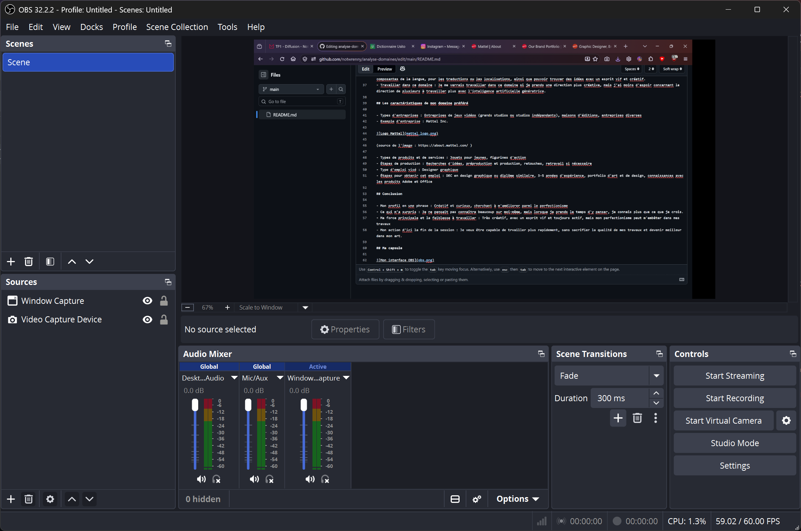

# Analyse du domaine — Wren Pamplin

## Découverte de soi

- Mes forces : Créativité
    - Exemple : Capacité de pouvoir venir avec des plans et des idées interessantes et complexes à partir de simples descriptions pour arriver à un produit final.
- Mes faiblesses ou points à améliorer : perfectionnisme
    - Exemple : Vouloir toujours faire le plus possible, au point où les travaux préoccupent tout mon temps sans que je prends du repos ou des pauses.
- Seul(e) ou en équipe : Seul
    - Pourquoi et exemple : Préférence pour travailler seul, puisque je préfère avoir une concentration totale sur les travauz sans distractions d'autri ou retards dans les remises. Par example, un membre de mon équipe n'a pas fait sa part de travail, suscitant stress et anxiété de ma part puisque l'enseignant demandait où était le travail complèt.
- Plutôt technique ou créatif : Créatif

## Exploration des domaines

###### | Domaine | Intérêt | Pourquoi |
| Graphisme | Fort | Fait parti du domaine des arts, utilise beaucoup de créativité, de patience, demande d'avoir un esprit vif, ce qui est nécessaire pour trouver des idées et les développer rapidement. |
| Vidéo et animation 2D | Moyen | Demande beaucoup de patience, néssecite de la créativité et demande de la répétition pour les images qui sont dessinées ou répétées. |
| 3D | Moyen | Demande beaucoup de patience, surtout pour l'optimisation, la création et possiblement l'animation d'un modèle 3D pour qu'il soit fluide. |
| Web | Moyen | Bonnes connaissances pour écrire du code, prends beaucoup de temps et je recherche constamment à donner le résultat le plus propre et le plus comprehensible possible. |
| Jeux vidéo | Fort | Inclut plusieurs domaines, tels que le 2D et le 3D, mais utilise beaucoup de créativité pour créer des plans, des idées de base. |
| Développement logiciel | Moyen | Nécessite une bonne connaissance des divers systèmes opérationels qui sont utilisés, ainsi que la patience pour s'assurer que tout soit fonctionnel sans grands problèmes. |
| Installations et expériences immersives | Moyen | Utilise beaucoup la créativité, mais nécessite une connaissance possible du matériel dont l'instalation comporte dessus.
## Mes 2 domaines préférés

### Domaine 1 : Graphisme

- Expérience : Expérience avec des cours d'illustration, des travaux pour créer des logos, des bannières de sites webs. Dessin en général, ayant une bonne base anatomique et un style personnel développé.
- Logiciels et outils : GIMP, Photoshop, Krita, Clip Studio, Procreate, Flipnote Studio (DSi/3DS, animation), etc.
- Pourquoi il m'intéresse : Je peux continuer de m'améliorer dans mon art, pouvant aussi travailler dans un domaine qui m'interesse et qui utilise surtout mes connaissances en arts.
- Travailler dans ce domaine : Je me vois travailler dans ce domaine, puisqu'il me donnerait la chance de travailler avec quelque chose que j'aime, tout en ayant la possibilité d'exploiter mon talent à des fins utiles.

### Domaine 2 : Jeux vidéo

- Expérience : Aucune grande expériance, autre qu'avoir utilisé RPG Maker et Roblox Studio, ainsi qu'avpir joué à une multitude de jeux.
- Logiciels et outils : Unity, RPG Maker
- Pourquoi il m'intéresse : Ce domaine combine plusieurs aspects du multimédia, comme les arts, ce qui m'intéresse beaucoup. On peut aussi y retrouver des composantes de la langue, pour les traductions ou les localisations, ainsi que pouvoir trouver des idées avec un esprit vif et créatif.
- Travailler dans ce domaine : Je me verrais travailler dans ce domaine si je prends une direction plus créative, mais j'ai moins d'espoir concernant la direction de plusieurs à travailler plus avec l'inteligence artificielle génératrice.

## Les caractéristiques de mon domaine préféré

- Types d'entreprises : Entreprises de jeux vidéos (grands studios ou studios indépendants), maisons d'éditions, entreprises diverses
- Exemple d'entreprise : Mattel Inc.

(source de l'image : https://about.mattel.com/ )

- Types de produits et de services : Jouets pour jeunes, figurines d'action
- Étapes de production : Recherches d'idées, préproduction et production, retouches, retravail si nécessaire
- Type d'emploi visé : Designer graphique
- Étapes pour obtenir cet emploi : DEC en design graphique ou diplôme similaire, 3-5 années d'expérience, portfolio d'art et de design, connaissances avec les produits Adobe et Office

## Conclusion

- Mon profil en une phrase : Créatif et curieux, cherchant à m'améliorer parmi le perfectionisme
- Ce qui m'a surpris : Je ne pensait pas connaître beaucoup sur moi-même, mais lorsque je prends le temps d'y penser, je connaîs plus que ce que je crois.
- Ma force principale et la faiblesse à travailler : Très créatif, avec un esprit vif et toujours actif, mais mon perfectionisme peut m'embêter dans mes travaux
- Mon action d'ici la fin de la session : Je veux être capable de trvailler plus rapidement, sans sacrifier la qualité de mes travaux et devenir meilleur dans mon art.

## Ma capsule

